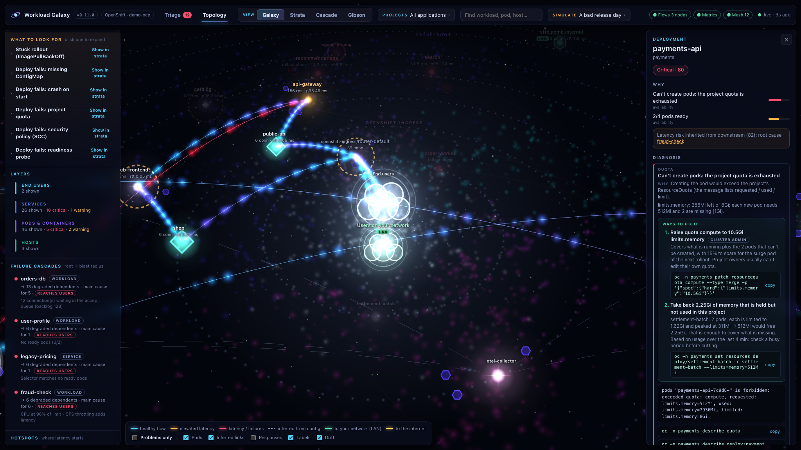
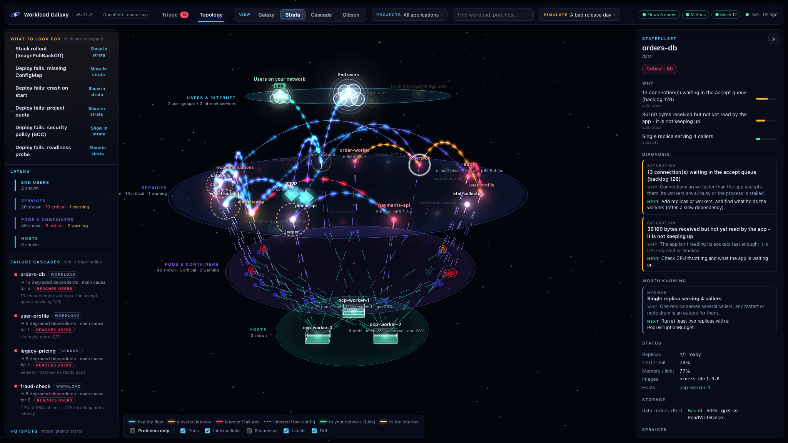
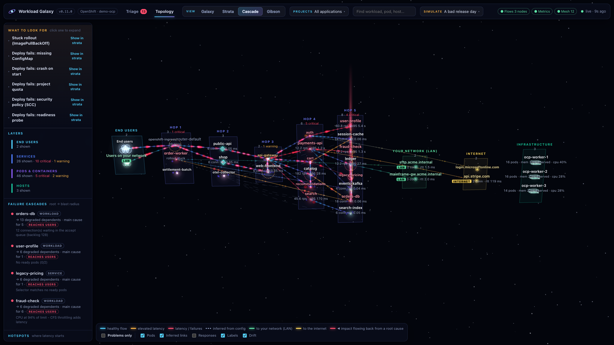
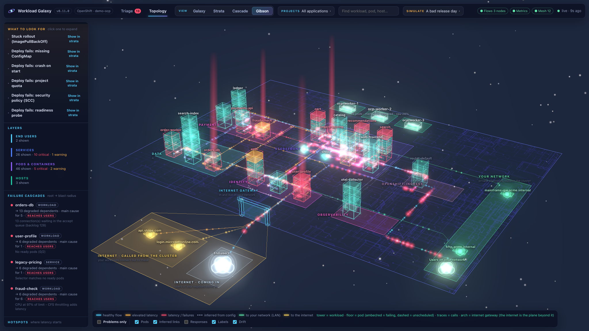
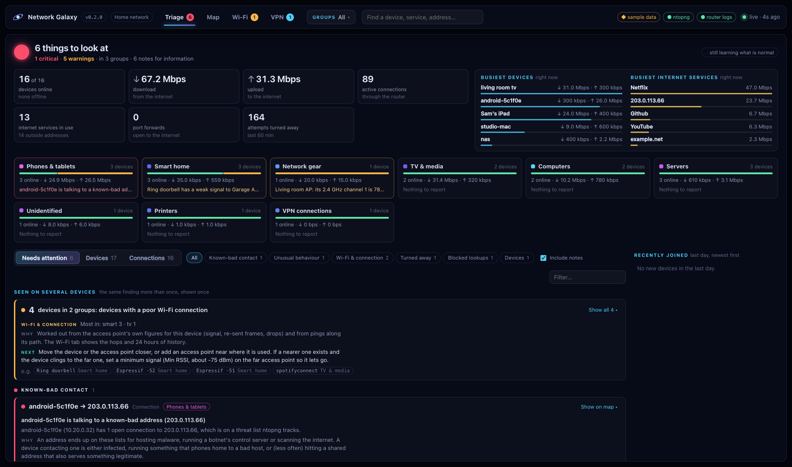
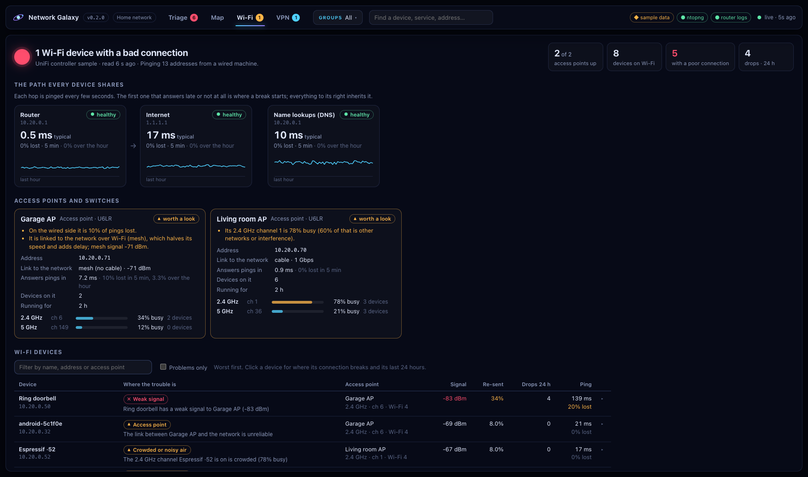

# Workload Galaxy

A suite of live, explorable maps of the systems you run. Each module watches one kind of
system, draws it as an animated 3D galaxy, and tells you in plain words what is wrong,
why, and what to do about it.


Every screenshot on this page comes from the built-in demo data, so you can reproduce all
of them on a laptop with no cluster and no router ([Try it](#try-it)).

## Modules

| Module | Watches | Version | Docs |
|---|---|---|---|
| [Kubernetes](modules/kubernetes) | Kubernetes and OpenShift projects: workloads, pods, hosts, who calls whom, and where latency starts | 0.11.0 | [README](modules/kubernetes/README.md) · [changelog](modules/kubernetes/CHANGELOG.md) |
| [Network](modules/network) | A home or small-office network behind a pfSense router: every device, what it talks to, what the firewall turns away, Wi-Fi and VPN | 0.2.0 | [README](modules/network/README.md) · [changelog](modules/network/CHANGELOG.md) |

Each module is a separate service with its own image, version and deployment. They share
a design, a graph format and an API shape, described under [How it fits together](#how-it-fits-together).

## Kubernetes module

Start in **Triage** when something is broken. It lists every problem with its likely
cause, the evidence, copy-ready `oc` / `kubectl` commands, and sized fixes ("raise the CPU
limit from 500m to 1"). Symptoms are folded under the root cause they clear with.


Click anything on the map for its diagnosis, latest rollout, warning events and status.



The same cluster in three more views, all sharing one selection:

| View | Shows |
|---|---|
| **Strata** | Stacked planes: end users, services, pods and containers, hosts |
| **Cascade** | The call graph as a left-to-right waterfall, one column per hop, with failures flowing back from their root cause |
| **Gibson** | The cluster as a city: towers are workloads, floors are pods, traces are calls |







It reads the cluster API, and optionally mesh metrics and a node agent (a DaemonSet that
reports live flows, kernel round-trip times, retransmits and queue backpressure). It scales
to large estates by rolling healthy projects up and drawing only what is failing. See the
[module README](modules/kubernetes/README.md) for what it can diagnose, deployment on
k3s / Rancher and OpenShift, configuration and security.

## Network module

A star is a device, a point beyond the gateway is an internet service (grouped by name,
not address), and a line is traffic.


**Triage** reports findings in plain words: a device talking to a known-bad address,
unusual upload volume, port forwards open to everyone, port scans, repeated blocked
lookups, newly joined devices.



**Wi-Fi** shows where a connection breaks: latency and loss hop by hop, each access
point's channel load, and every wireless device's signal and drops. A **VPN** tab lists
who is connected and failed logins.



It reads ntopng and the firewall's syslog on a pfSense router, and optionally a UniFi
controller. Addresses can be blocked from the page behind a separate action password;
viewing needs none. See the [module README](modules/network/README.md) for router setup,
the site file and configuration.

## Try it

Both modules run on made-up data with nothing to connect to.

**Kubernetes**, in Docker (a simulated OpenShift cluster with six deployments failing six ways):

```bash
modules/kubernetes/scripts/demo-local.sh        # opens http://127.0.0.1:8099/?view=triage
modules/kubernetes/scripts/demo-local.sh stop
```

The **Simulate** menu in the top bar switches between five presets and 24 single fault
scenarios. `demo-local.sh enterprise` simulates a 600-project estate instead.

**Network**, from a Python virtual environment (a sample network of 16 devices with one of
each kind of finding):

```bash
cd modules/network
python3 -m venv .venv && .venv/bin/pip install -r collector/requirements.txt
cd collector
NETGALAXY_MODE=sample NETGALAXY_SYSLOG_PORT=0 NETGALAXY_SINKHOLE_IPS=10.99.0.1 \
  NETGALAXY_ROUTER_IP=10.20.0.1 NETGALAXY_LAN_CIDRS=10.20.0.0/24 \
  ../.venv/bin/uvicorn netgalaxy.main:app --port 8098
# open http://127.0.0.1:8098/
```

## How it fits together

Every module has the same three parts:

| Part | What it is |
|---|---|
| `collector/` | A Python (FastAPI) service that reads its data source, builds a graph of nodes and calls, scores risk, and serves the API and the UI from one container |
| `web/` | The UI: Three.js, vendored, no build step and no CDN, so it works air-gapped |
| `deploy/` | Kustomize manifests; the collector runs as a non-root container |

They also share an API shape under `/api/v1/` (`meta`, `topology`, `node`, `workloads`,
`calls`, `search`, `hotspots`, `triage`) and an embedding contract: any module's UI runs
in an iframe with `?embed=1` and exchanges selection and view changes over `postMessage`.

```
modules/
  kubernetes/   collector, node agent, web UI, deploy (k8s, homelab, openshift), tests
  network/      collector, web UI, deploy (k8s, homelab, router sync script), tests
docs/
  screenshots/
```

Tests run per module, from a virtual environment in the module directory:

```bash
cd modules/kubernetes        # or modules/network
python3 -m venv .venv && .venv/bin/pip install -r collector/requirements.txt pytest
.venv/bin/python -m pytest -q tests
```

## Roadmap

The modules began as one project and a copy of it, so today they duplicate the front end
and parts of the collector. Planned, not yet built:

1. **Shared core.** Move the common collector code (app factory, state, paging and search)
   and the common front end (scene, layout, triage, embed API) into `core/`, with each
   module registering its own routes, table columns, node kinds and panels.
2. **Suite shell.** One landing page that discovers running modules through `/api/v1/meta`
   and embeds them, with links between modules (a pod's host to the same machine on the
   network map).
3. **More modules.** Any source that can be drawn as nodes and calls.
