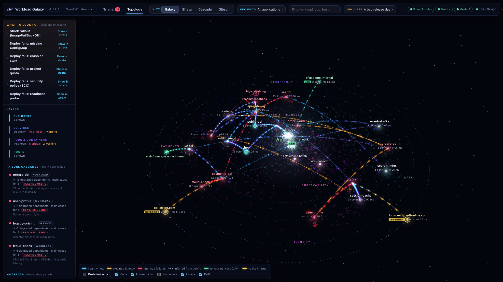
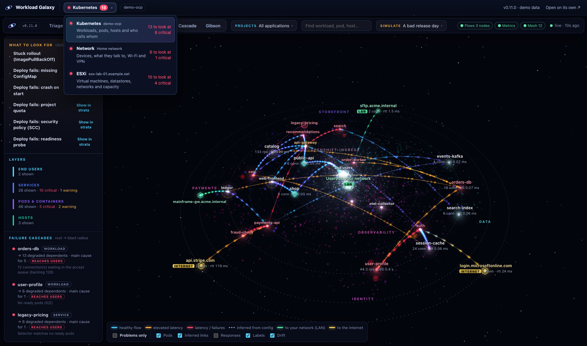
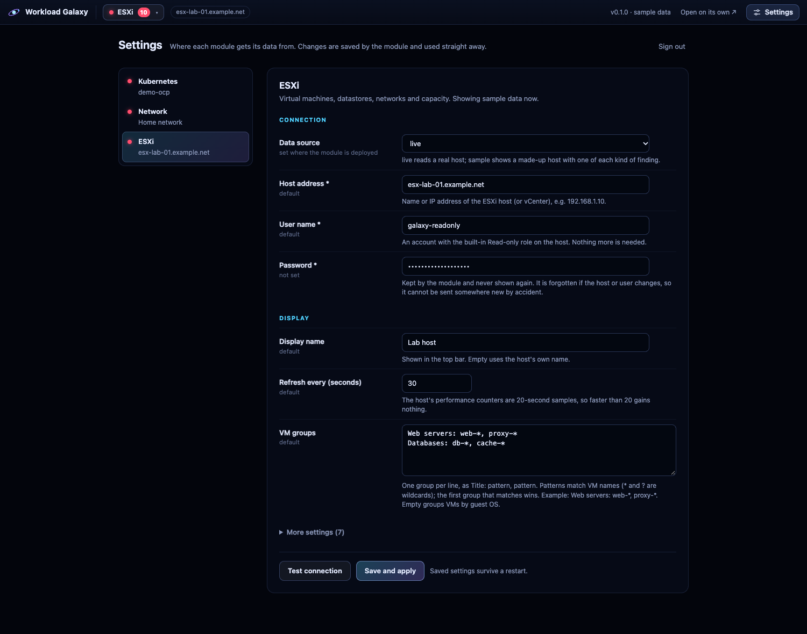
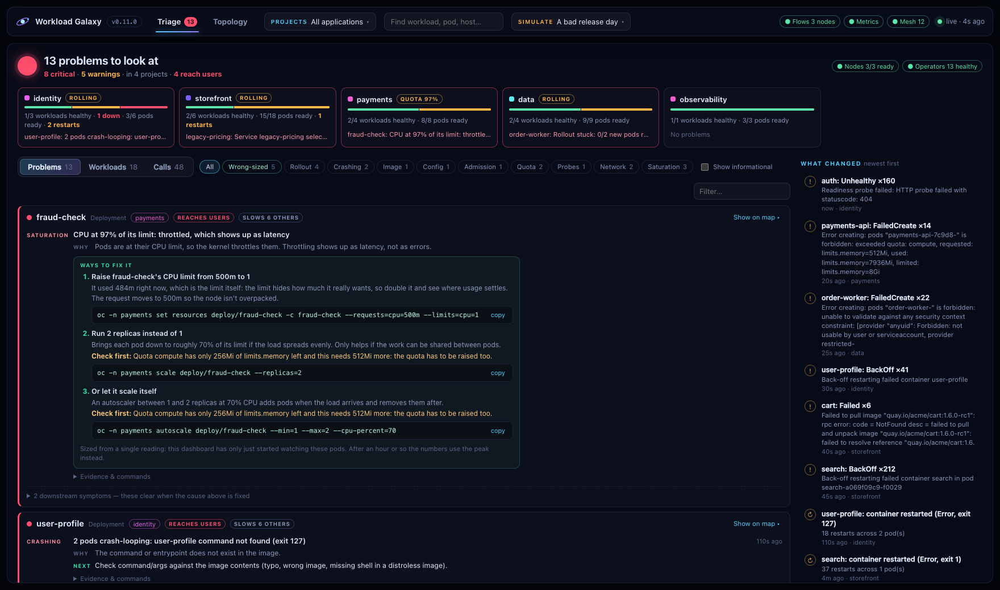
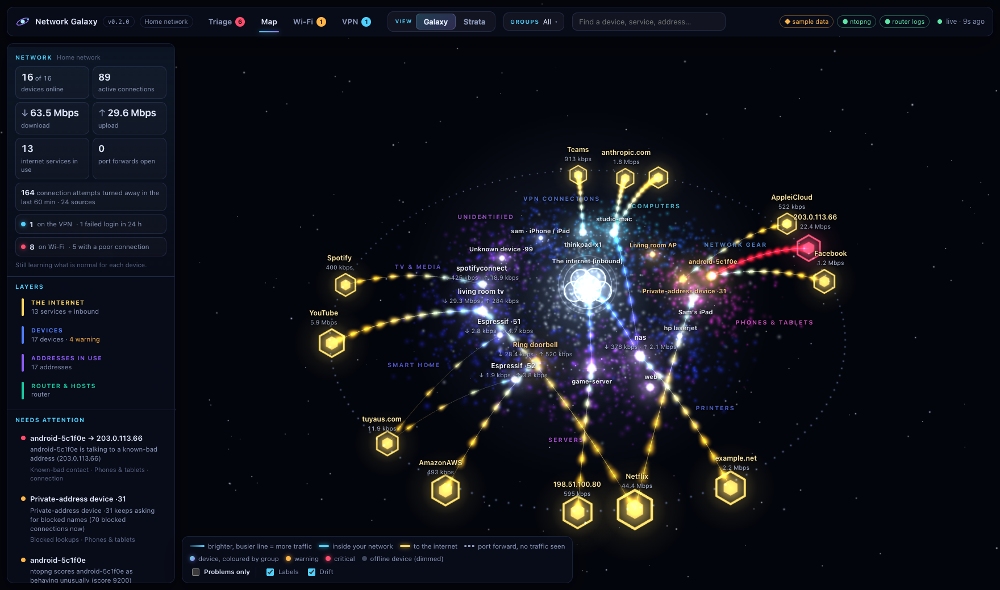
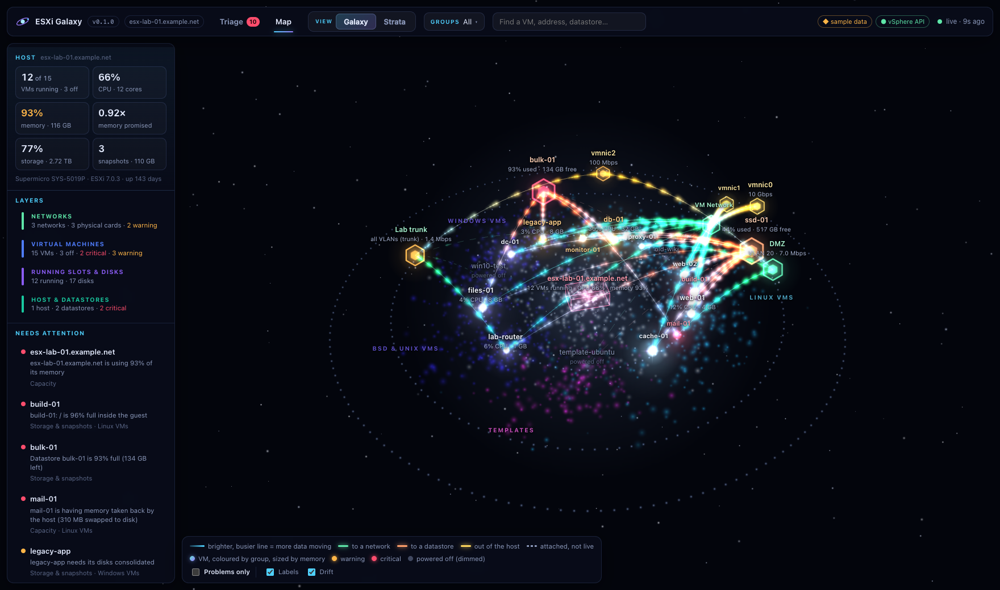
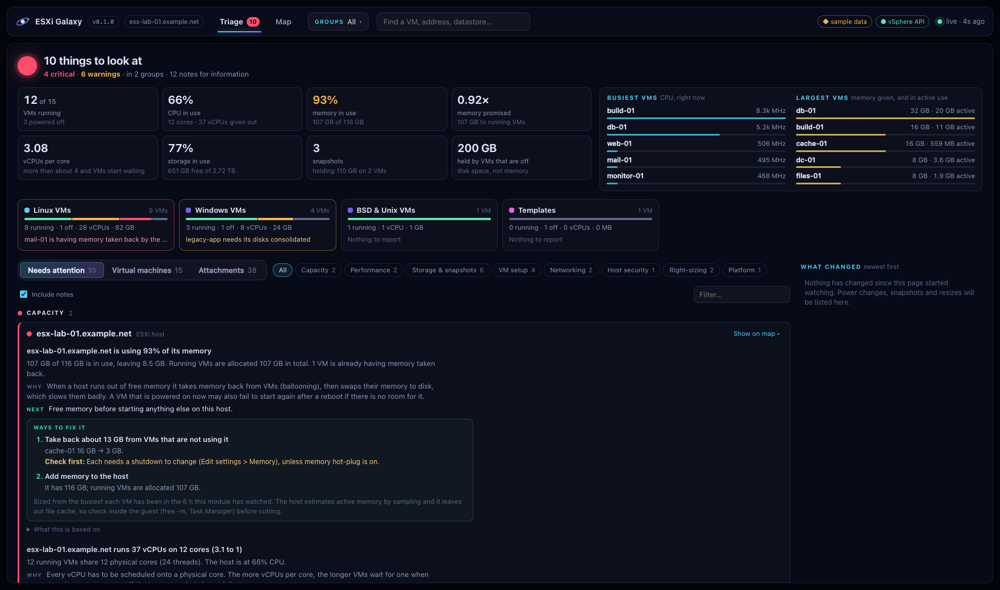
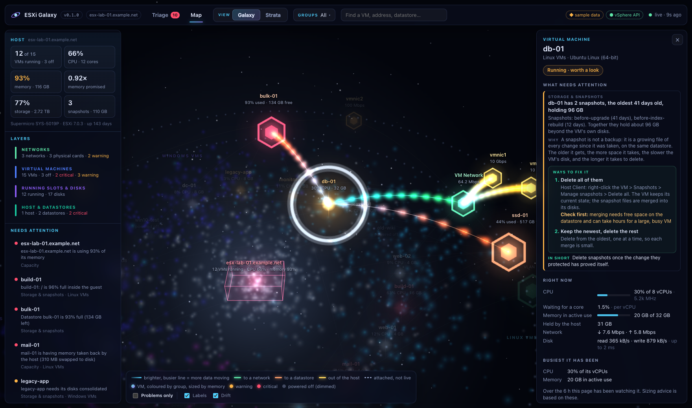
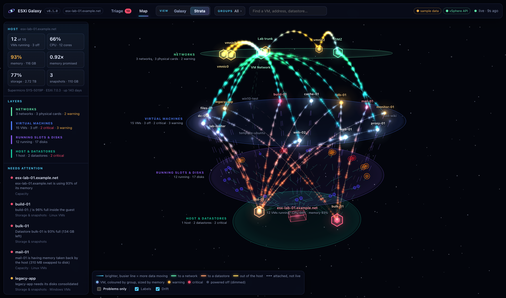

# Workload Galaxy

A suite of live, explorable maps of the systems you run. Each module watches one kind of
system, draws it as an animated 3D galaxy, and tells you in plain words what is wrong,
why, and what to do about it.



Every screenshot on this page comes from the built-in demo data, so you can reproduce all
of them on a laptop with no cluster and no router ([Try it](#try-it)).

## Modules

| Module | Watches | Version | Docs |
|---|---|---|---|
| [Kubernetes](modules/kubernetes) | Kubernetes and OpenShift projects: workloads, pods, hosts, who calls whom, and where latency starts | 0.11.0 | [README](modules/kubernetes/README.md) · [changelog](modules/kubernetes/CHANGELOG.md) |
| [Network](modules/network) | A home or small-office network behind a pfSense router: every device, what it talks to, what the firewall turns away, Wi-Fi and VPN | 0.2.0 | [README](modules/network/README.md) · [changelog](modules/network/CHANGELOG.md) |
| [ESXi](modules/esxi) | A VMware ESXi host: virtual machines, the networks and datastores they hang off, capacity and right-sizing | 0.1.0 | [README](modules/esxi/README.md) · [changelog](modules/esxi/CHANGELOG.md) |

Each module is a separate service with its own image, version and deployment. They share
a design, a graph format and an API shape, described under [How it fits together](#how-it-fits-together).

## One bar for all of them

The [shell](shell) puts the modules behind one address. Its bar carries the suite's name and a
drop-down that switches module; each entry shows what that module is watching and how many
things there need attention, so trouble in one is visible while you are looking at another.



**Settings**, at the right of the bar, is where each module is told what to read: its host, its
account, how things are grouped. It is behind one admin sign-in; a module's form is drawn from
the settings the module declares, values can be tested before they are saved, and passwords are
never shown back. Saved settings take effect at once, with no redeploy.



ESXi is configured this way today. The Kubernetes and Network modules still take their settings
where they are deployed.

## Kubernetes module

Start in **Triage** when something is broken. It lists every problem with its likely
cause, the evidence, copy-ready `oc` / `kubectl` commands, and sized fixes ("raise the CPU
limit from 500m to 1"). Symptoms are folded under the root cause they clear with.



Click anything on the map for its diagnosis, latest rollout, warning events and status.


The same cluster in three more views, all sharing one selection:

| View | Shows |
|---|---|
| **Strata** | Stacked planes: end users, services, pods and containers, hosts |
| **Cascade** | The call graph as a left-to-right waterfall, one column per hop, with failures flowing back from their root cause |
| **Gibson** | The cluster as a city: towers are workloads, floors are pods, traces are calls |


It reads the cluster API, and optionally mesh metrics and a node agent (a DaemonSet that
reports live flows, kernel round-trip times, retransmits and queue backpressure). It scales
to large estates by rolling healthy projects up and drawing only what is failing. See the
[module README](modules/kubernetes/README.md) for what it can diagnose, deployment on
k3s / Rancher and OpenShift, configuration and security.

## Network module

A star is a device, a point beyond the gateway is an internet service (grouped by name,
not address), and a line is traffic.



**Triage** reports findings in plain words: a device talking to a known-bad address,
unusual upload volume, port forwards open to everyone, port scans, repeated blocked
lookups, newly joined devices.


**Wi-Fi** shows where a connection breaks: latency and loss hop by hop, each access
point's channel load, and every wireless device's signal and drops. A **VPN** tab lists
who is connected and failed logins.


It reads ntopng and the firewall's syslog on a pfSense router, and optionally a UniFi
controller. Addresses can be blocked from the page behind a separate action password;
viewing needs none. See the [module README](modules/network/README.md) for router setup,
the site file and configuration.

## ESXi module

The host sits at the centre, its VMs orbit it by group and are sized by the memory they have
been given, and what they hang off sits on the rim: datastores, port groups, and the physical
network cards behind them. Powered-off VMs stay on the map, dimmed, because they still hold
disk space.



**Triage** shows how full the host is and every finding with sized ways to fix it: which VMs
could give memory back and how much that frees, which snapshots and powered-off VMs hold the
most space on a full datastore.



Click a VM for what it is using now, the busiest it has been, its disks, adapters and
snapshots. **Strata** stacks the same host as networks, VMs, each VM's running slot and disks,
and the host and datastores underneath.





It reads the host through the vSphere API with a read-only account, changes nothing and
installs nothing on it; the free ESXi licence is enough. See the
[module README](modules/esxi/README.md) for the account setup, what it checks, and its limits.

## Try it

Every module runs on made-up data with nothing to connect to.

**Kubernetes**, in Docker (a simulated OpenShift cluster with six deployments failing six ways):

```bash
modules/kubernetes/scripts/demo-local.sh        # opens http://127.0.0.1:8099/?view=triage
modules/kubernetes/scripts/demo-local.sh stop
```

The **Simulate** menu in the top bar switches between five presets and 24 single fault
scenarios. `demo-local.sh enterprise` simulates a 600-project estate instead.

**Network**, from a Python virtual environment (a sample network of 16 devices with one of
each kind of finding):

```bash
cd modules/network
python3 -m venv .venv && .venv/bin/pip install -r collector/requirements.txt
cd collector
NETGALAXY_MODE=sample NETGALAXY_SYSLOG_PORT=0 NETGALAXY_SINKHOLE_IPS=10.99.0.1 \
  NETGALAXY_ROUTER_IP=10.20.0.1 NETGALAXY_LAN_CIDRS=10.20.0.0/24 \
  ../.venv/bin/uvicorn netgalaxy.main:app --port 8098
# open http://127.0.0.1:8098/
```

**ESXi**, the same way (a sample host with 15 VMs and one of each kind of finding):

```bash
cd modules/esxi
python3 -m venv .venv && .venv/bin/pip install -r collector/requirements.txt
cd collector
PYTHONPATH=../../../core/py ESXIGALAXY_MODE=sample ../.venv/bin/uvicorn esxigalaxy.main:app --port 8097
# open http://127.0.0.1:8097/
```

**The shell**, once any of the modules above are running (use the ports you started them on):

```bash
cd shell
python3 -m venv .venv && .venv/bin/pip install -r app/requirements.txt
cd app
PYTHONPATH=../../core/py GALAXY_MODULES="kubernetes=http://127.0.0.1:8099,network=http://127.0.0.1:8098,esxi=http://127.0.0.1:8097" \
  ../.venv/bin/uvicorn galaxyshell.main:app --port 8089
# open http://127.0.0.1:8089/
```

## How it fits together

Every module has the same three parts:

| Part | What it is |
|---|---|
| `collector/` | A Python (FastAPI) service that reads its data source, builds a graph of nodes and calls, scores risk, and serves the API and the UI from one container |
| `web/` | The UI: Three.js, vendored, no build step and no CDN, so it works air-gapped |
| `deploy/` | Kustomize manifests; the collector runs as a non-root container |

They also share an API shape under `/api/v1/` (`meta`, `topology`, `node`, `workloads`,
`calls`, `search`, `hotspots`, `triage`) and an embedding contract: any module's UI runs
in an iframe with `?embed=1` and exchanges selection and view changes over `postMessage`.

The shared part lives in `core/py/galaxy_core`: declaring a module's settings once, building
nodes, edges and findings in the graph format, the refresh loop, and the API above. The ESXi
module is built on it. The Kubernetes and Network modules came first and still carry their own
copies of that code.

Each module built on the core also serves a manifest at `/api/v1/module` (what it is, what it
needs, and the settings it takes) and a settings API the suite's Settings page reads and writes.
A module accepts changes only from a caller that presents the settings token it shares with the
shell.

```
core/
  py/galaxy_core/   settings, graph builders, scoping, tables, refresh loop, shared API; tests
modules/
  kubernetes/   collector, node agent, web UI, deploy (k8s, homelab, openshift), tests
  network/      collector, web UI, deploy (k8s, homelab, router sync script), tests
  esxi/         collector, web UI, deploy (k8s, homelab), tests
shell/            the suite bar and module selector: app, web UI, deploy (k8s, homelab), tests
docs/
  screenshots/
```

Tests run per module, from a virtual environment in the module directory:

```bash
cd modules/kubernetes        # or modules/network
python3 -m venv .venv && .venv/bin/pip install -r collector/requirements.txt pytest
.venv/bin/python -m pytest -q tests
```

## Roadmap

Planned, not yet built:

1. **Move the Kubernetes and Network modules onto the core.** Their collectors still duplicate
   what `galaxy_core` now provides.
2. **A shared front end.** Each module carries its own copy of the 3D engine and panels; the
   common parts should move to `core/web`, with each module supplying its node kinds, tables
   and panels.
3. **Switching modules on from the page.** The Settings page configures the modules the shell
   is told about. Next: adding a module by URL and switching built-in ones on from the same
   page, instead of listing them in the shell's own settings.
4. **Links between modules.** The same machine is a VM on the ESXi map, a device on the
   network map and a node on the Kubernetes map; selecting it in one should lead to the others.
5. **More modules.** Any source that can be drawn as nodes and connections.
